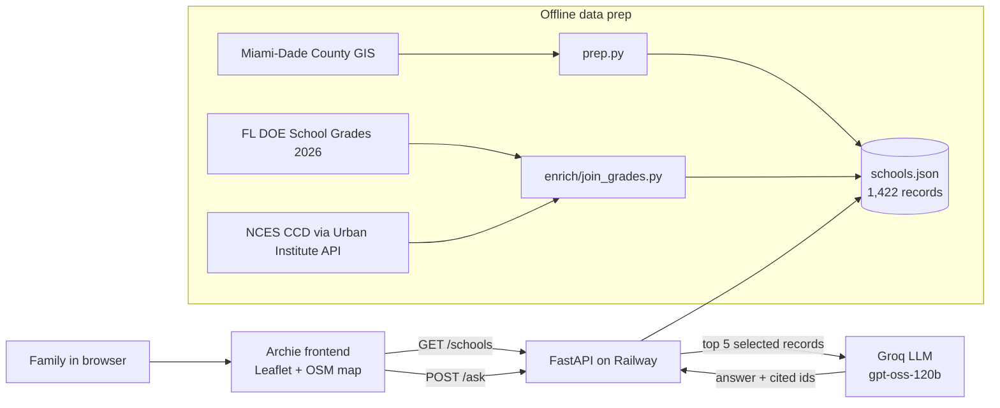

# Compass305 — Miami-Dade School Navigator

**eMerge AI Hackathon 2026 · Education track**

Finding a school in Miami-Dade means juggling the district finder (public only), private-school lists, state report cards, and phone calls — often in a second language. Compass305 puts **public and private schools on one map**, adds **official state grades**, and answers families' questions **with citations, in English, Spanish, or Haitian Creole**.

- **Live API:** https://compass305-production.up.railway.app
- **Frontend:** built in Archie (map-first UI, Leaflet + OpenStreetMap)

## Features
- **One map, 1,422 schools:** 451 public and 971 private, filtered by address, grade (PK–12), radius, and type.
- **Official ratings:** FL DOE 2026 school grade with reading and math proficiency for 356 public schools; charter, magnet, Title I, and students per teacher from NCES.
- **Ask Compass (grounded AI):** answers only from the selected school records, with clickable citations. If the data can't answer, it says "Not in our data" instead of guessing.
- **General info (opt-in):** a clearly labeled, unverified fallback answer that tells families to confirm with the school.
- **Multilingual:** replies in the language of the question (EN / ES / HT).
- **Compare:** side-by-side grade, distance, enrollment, and ratings.
- **Honest sourcing:** every card shows its source and pull date.

## Architecture


## API
| Endpoint | Purpose |
|---|---|
| `GET /schools?lat&lon&grade&radius_km&type` | Up to 50 nearest schools with `distance_km`. `grade` accepts `PK`, `K`, or `1`–`12`. |
| `GET /schools/{id}` | One school record. |
| `POST /ask` `{question, school_ids, mode}` | `mode: "grounded"` (default) returns `{answer, cited_ids, found}`; `mode: "general"` returns a labeled general answer. Uses the first 5 ids. |

## Data sources
| Source | Fields | Year |
|---|---|---|
| [Miami-Dade County GIS](https://gisweb.miamidade.gov/arcgis/rest/services/MD_Emaps/MapServer) | Name, location, grades, enrollment, phone | Pulled 2026-10-17 |
| [FL DOE School Grades](https://www.fldoe.org/accountability/accountability-reporting/school-grades/) | `state_grade`, `reading_pct`, `math_pct` | 2025-26 |
| [NCES Common Core of Data](https://educationdata.urban.org/documentation/) | `charter`, `student_teacher_ratio` (2023); `magnet`, `title_i` (2021) | 2021–2023 |

Private schools aren't graded by the state, so they show "Private — not graded by the state."

## Run locally
```bash
git clone https://github.com/n5gus/compass305 && cd compass305
python3 -m venv .venv && source .venv/bin/activate
pip install -r requirements.txt
echo "LLM_API_KEY=your_groq_key" > .env   # free key at console.groq.com
echo "MODEL=openai/gpt-oss-120b" >> .env
uvicorn main:app --reload --port 8080
```

## Responsible AI
- Grounded mode answers only from the records sent and cites them; unanswerable questions return `found: false` with no sources.
- General answers are opt-in and labeled as unverified.
- No user accounts, no personal data stored, and API keys live only in environment variables.

## Next steps
- School websites and enrollment zones (attendance boundaries)
- Transit and commute times
- More languages and a mobile layout

## Team
Edouard Pierre-Louis — Miami Dade College (Cybersecurity)
